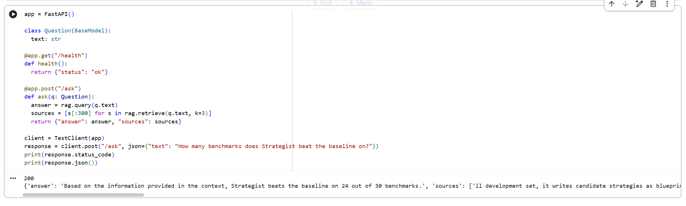

# RAG Paper Q&A — Built From Scratch (No Frameworks)

A retrieval-augmented generation (RAG) system that answers questions about
research papers, grounded in the source text. Every component is implemented
**from scratch — without RAG frameworks** (no LangChain / LlamaIndex) to
understand the mechanics end to end.

## What it does

Given one or more papers (PDF), the system retrieves the most relevant
passages for a question and generates an answer grounded in those passages —
reducing hallucination and letting you trace where the answer came from.

Example (over two arXiv cs.AI papers):
- **Q:** "How many benchmarks does Strategist beat the baseline on?"
- **A:** "Strategist beats the baseline on 24 out of 30 benchmarks." *(correct — matches the paper's abstract)*

## How it works

```
PDF → text → chunking → embeddings → vector search (FAISS)
     → reranking (cross-encoder) → grounded generation (LLM) → answer
```
## Object-Oriented Design

The pipeline is built as modular classes:

| Class | Responsibility |
|-------|----------------|
| `Chunker` | Split documents into overlapping chunks |
| `Embedder` | Encode text into vectors (sentence-transformers) |
| `VectorStore` | Store vectors and run similarity search (FAISS) |
| `Reranker` | Re-score candidates with a cross-encoder |
| `Generator` | Build a grounded prompt and generate an answer (LLM) |
| `RAGPipeline` | Orchestrate indexing and querying (composition) |

## Tech Stack

Python, sentence-transformers (all-MiniLM-L6-v2), FAISS, cross-encoder
(ms-marco-MiniLM), Qwen2.5 (local LLM via Hugging Face Transformers),
pypdf, NumPy.

## Evaluation

Retrieval was measured with **Hit@5** on a small, hand-built evaluation set
over two real arXiv papers: **Hit@5 = 5/5** — the correct passage was in the
top-5 retrieved chunks for every question. *(Small set; a promising signal,
not a statistically robust number.)*

Hit@k measures retrieval quality, not answer faithfulness — answers should
still be verified against the source, especially with a small LLM.
## API & Deployment (FastAPI + Docker)

The RAG pipeline is wrapped as a REST API with **FastAPI** and containerized with **Docker**.

### Endpoints
- `GET /health` — health check
- `POST /ask` — send a question, get a grounded answer with its source passages
  - Request: `{ "text": "your question" }`
  - Response: `{ "answer": ..., "sources": [...] }`

### Run with Docker
​```bash
docker build -t rag-api .
docker run -p 8000:8000 rag-api
​```
Open http://127.0.0.1:8000/docs for the interactive Swagger UI.

> Note: `api.py` ships with a lightweight **mock mode** so the service runs instantly without downloading models. The full RAG pipeline (`/ask` calling the real retriever + generator) is shown below.

### Example `/ask` output (real RAG)

## How to run

1. Open the notebook in Google Colab.
2. Upload one or more research-paper PDFs.
3. Run the cells top to bottom to index the papers and ask questions.

## Limitations & next steps

- Uses a small local LLM (Qwen2.5-0.5B/1.5B); answers can be terse or slightly
  embellished — a larger model improves generation quality.
- The evaluation set is small; expanding it would give a more reliable score.
- In-memory FAISS index — **next step: move to a persistent vector database
  (e.g., Chroma / pgvector).**
- By default the Docker image runs in mock mode; wiring the full RAG into the
  container is the natural follow-up.
